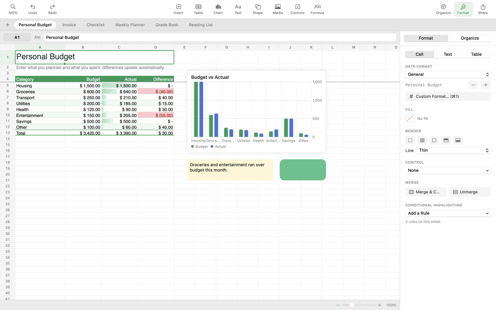

# Figures

A spreadsheet app for macOS and iOS that opens and saves Excel workbooks (`.xlsx`, and `.xlsm` read-only).
One Swift engine (`SheetCore`) and one SwiftUI interface (`SheetUI`) serve both platforms.

## Build

| Target | Requirement | Command |
|---|---|---|
| Mac app | Command Line Tools | `./scripts/build-mac-app.sh`, then `open build/Figures.app` |
| iPhone / iPad app | Full Xcode | `cd Apple && xcodegen && open Figures.xcodeproj`, choose **Figures-iOS**, set your team, Run |
| Engine checks | Command Line Tools | `swift run SheetCoreChecks` |
| Interface snapshot | Command Line Tools | `swift run FiguresSnapshot file.xlsx out.png` (`FIGURES_DARK=1` for Dark Mode) |
| Inspect any workbook | Command Line Tools | `swift run SheetCoreChecks file.xlsx` (set `FIGURES_VERBOSE=1` to list failing formulas) |
| Sample workbook | Command Line Tools | `swift run SheetCoreChecks --tour Samples/Tour.xlsx` |
| Calculation benchmark | Command Line Tools | `swift run -c release SheetCoreChecks --bench` |

## Opening Excel files

Figures reads what most workbooks use: values, formulas (including shared formulas and defined names), the
workbook theme (theme colors with tints, legacy indexed colors), the default font, per-cell fonts, sizes,
colors, fills, borders with styles and colors, alignment, wrap text, indent, Excel number format codes
(sections, colors, conditions, dates, times, fractions, scientific, accounting), column widths, row heights,
hidden rows and columns, merged cells, frozen rows, gridlines, AutoFilter, and conditional formatting
(cell value, text, duplicates, top/bottom, above/below average, formula rules, color scales, data bars).

Checked against Apache POI's 356 test workbooks: 333 open. The rest are intentionally corrupt fuzzing
files, XML-bomb tests and two encrypted or Excel 97–2003 files, which get a clear message instead.

Not read from Excel files: Excel's own charts, images and shapes (Figures' canvas objects are saved in a
Figures section of the file that Excel ignores), comments, pivot tables, tables' structured references (`Table1[Amount]`),
data validation, icon sets, rich text within a cell (the text is kept, its mixed formatting is not),
external workbook links, and macros (`.xlsm` opens, saves as `.xlsx`).

## Interface

Figures is laid out like a Mac app rather than a copy of Excel:

- **Toolbar:** Zoom and view options, Undo and Redo, then Insert, Table, Chart, Text, Shape, Media, Controls and
  Formula, then Organize, Format and Share.
- **Sheet tabs** sit above the grid; click + to add a sheet, double-click a tab to rename it.
- **Format inspector** (right): Cell (data format, fill, borders, controls, merge, conditional highlighting), Text
  (font, size, style, color, alignment, wrap, indent, cell styles), Table (table styles, rows and columns, frozen
  header rows, gridlines, sizing and hidden rows) and Object (position, size, colors and chart settings).
- **Organize inspector:** sort, filter, Summarize by Category, remove duplicates, find and replace, and a list of
  the sheet's highlighting rules.
- **Canvas:** live charts, text boxes, shapes and pictures float over the cells; drag to move, drag the corner
  handle to resize, Delete to remove. Charts follow their data as it changes and as rows are inserted.
- **Share** sends a copy of the workbook as an `.xlsx` file through the system share menu.
- **Status bar:** Quick Calculations (Sum, Average, Min, Max, Count) for the selection, and zoom.

The sheet itself stays white in Dark Mode, so workbook colors look as their authors intended.

Also: cell controls (checkboxes, star ratings, pop-up menus, steppers, sliders), templates, table styles,
AutoFill by dragging the selection's corner, filter dropdowns, right-click menus on cells and headers, column
and row resizing, a Name Box that jumps to cells or names, and formula autocomplete with argument hints.

Shortcuts: ⌘B ⌘I ⌘U · ⌘D fill down · ⌘R fill right · ⌘F find · ⌘1 format cells · ⌘; date · ⇧⌘; time ·
⇧⌘L filter · ⌃⇧4 currency · ⌃⇧5 percent · ⌘= / ⌘− zoom · Delete removes a selected object · Esc cancels.

## Formulas

About 160 functions (see `Sources/SheetCore/FunctionCatalog.swift`), Excel precedence and coercion, defined
names, cross-sheet and 3D references (`Jan:Mar!B2`), whole rows and columns, array constants, empty arguments,
INDIRECT and OFFSET. Inserting or deleting rows and columns updates references on every sheet.

## Not yet supported

Exporting canvas objects as Excel drawings, real-time collaboration, dynamic array formulas, structured table references, data validation,
comments, frozen columns, printing, and sheet renames updating formulas that refer to the old name.

## Privacy

Figures works entirely on your device. It collects no data, has no analytics and makes no network requests.
See [PRIVACY.md](PRIVACY.md).

## Important

Figures is provided as is, without warranty. Check important calculations independently, and keep a backup of
any workbook before saving it in Figures, because features it does not support are not kept. See
[DISCLAIMER.md](DISCLAIMER.md).

## License

The source code is available under the [MIT License](LICENSE). Copyright © 2026 Tarik Naeem.

The **Figures** name and the Grid F app icon are not licensed under the MIT License; see
[TRADEMARKS.md](TRADEMARKS.md). Forks and modified versions must use a different name and icon.

Figures is an independent project. It is not affiliated with, endorsed by or sponsored by Microsoft
Corporation or Apple Inc. Microsoft and Excel are trademarks of the Microsoft group of companies; they are
mentioned only to describe file compatibility. Figures contains no Microsoft code.

Contributions are welcome under the terms in [CONTRIBUTING.md](CONTRIBUTING.md). Security problems: see
[SECURITY.md](SECURITY.md).
